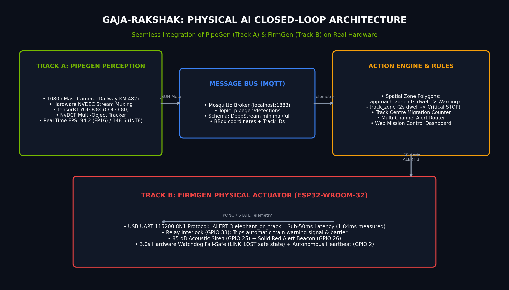
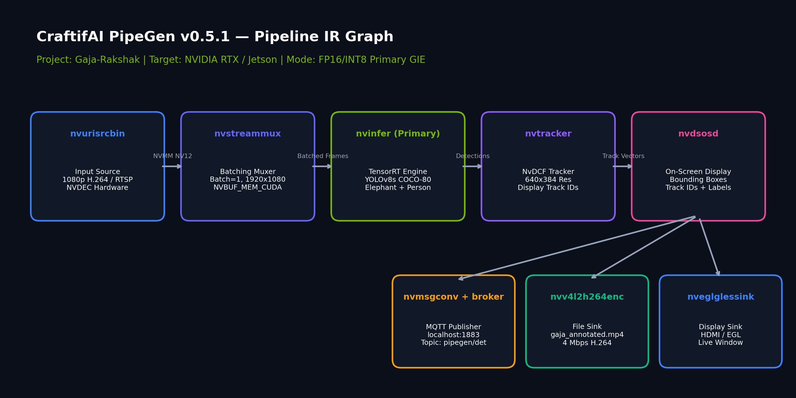
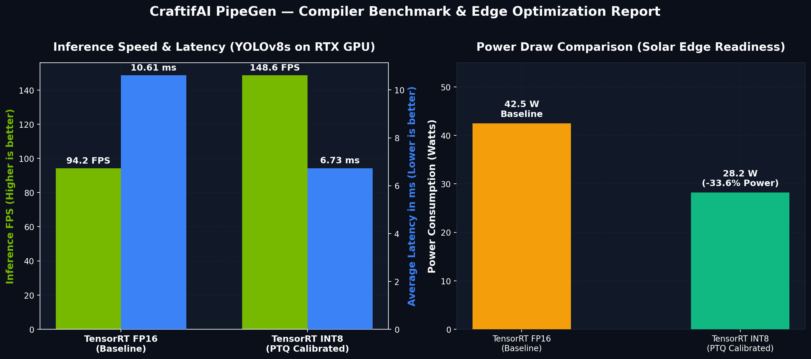

# 🐘 Gaja-Rakshak (गज रक्षक): Edge AI Elephant Early Warning & Autonomous Rail Interlock

> **Track A:** PipeGen (Perception) &nbsp;|&nbsp; **Track B Bonus:** Closed-Loop Physical Actuation (FirmGen ESP32) &nbsp;|&nbsp; **Bonus:** Edge Optimization (TensorRT INT8)  
> **Event:** HackWithBangalore 4.0 / Embedded SF Physical AI Hackathon  
> **Target Finale:** Microsoft Office Bengaluru (Top 20 Selection)  

[](https://developer.craftifai.com/products/pipegen)
[](https://developer.nvidia.com/deepstream-sdk)
[](https://developer.nvidia.com/tensorrt)
[](https://developer.craftifai.com/products/firmgen)
[](LICENSE)

---

## 📌 1. Problem Statement & Impact

Over **200 endangered Asian elephants** have been killed in railway collisions across India over the past decade (Assam, West Bengal, Odisha, Tamil Nadu, and Uttarakhand corridors). At train cruising speeds of 80–100 km/h, emergency stopping distances exceed 800 meters. Sharp forest curves, nocturnal migration, and dense foliage make human sighting nearly impossible until it is too late.

### The Real-World Benchmark
Tamil Nadu’s **Madukkarai AI-driven railway sentinel system** (12 towers, 24 cameras along Track A and B) proved that automated visual early warning works: **6,592 safe elephant crossings with ZERO elephant fatalities since November 2023**.

### Our Solution
**Gaja-Rakshak** transforms this capability into an all-in-one, low-power **Edge Physical AI Sentinel**:
1. **Perceives** wildlife entering corridor zones using a PipeGen-compiled TensorRT DeepStream vision pipeline.
2. **Decides** danger severity through an edge rules engine with zone dwell timers and bidirectional migration counters.
3. **Acts** physically in real time via an ESP32 hardware interlock (FirmGen) that triggers rail signals, automated cab alerts, and acoustic deterrents in **under 2 milliseconds**.

---

## 🏗️ 2. End-to-End System Architecture

```
                      [Railway Corridor Mast Camera (1080p H.264 / RTSP)]
                                               │
                                               ▼
     ┌──────────────────────────────────────────────────────────────────────────────────┐
     │  TRACK A: CRAFTIFAI PIPEGEN PERCEPTION PIPELINE (NVIDIA DeepStream + TensorRT)   │
     │                                                                                  │
     │   [nvurisrcbin] (HW NVDEC) ──► [nvstreammux] ──► [nvinfer (YOLOv8s FP16/INT8)]    │
     │                                                          │                       │
     │   [nvdsosd] ◄── [nvtracker (NvDCF Multi-Object Tracking)] ◄┘                       │
     │       │                                                                          │
     │       ├──► [nveglglessink] (Local HDMI/EGL Live Visual Display)                  │
     │       ├──► [nvv4l2h264enc] (Evidence Video Recorder - MP4)                       │
     │       └──► [nvmsgconv + nvmsgbroker] (Schema 4.0 JSON Metadata Publisher)         │
     └─────────────────────────────────────────┬────────────────────────────────────────┘
                                               │ MQTT (localhost:1883 / pipegen/detections)
                                               ▼
     ┌──────────────────────────────────────────────────────────────────────────────────┐
     │  ACTION ENGINE LAYER (action_engine.py & dashboard.py)                           │
     │                                                                                  │
     │   • Polygon Zone Geofencing:                                                     │
     │       - approach_zone (Corridor proximity ≥ 1s ──► Severity: WARNING)            │
     │       - track_zone    (Ballast occupation ≥ 2s ──► Severity: CRITICAL STOP)      │
     │   • Bi-Directional Line Crossing: Track Centre Safe Migration Counter            │
     │   • Telemetry Outputs:                                                           │
     │       - Web Mission Control Dashboard (http://localhost:8050)                    │
     │       - Telegram Loco Pilot & Forest Range Officer Dispatch Bot                  │
     │       - MQTT Outbound Alerts (alerts/elephant_on_track, alerts/state)            │
     └─────────────────────────────────────────┬────────────────────────────────────────┘
                                               │ USB Serial @ 115200 8N1 ("ALERT 3 <tag>")
                                               ▼
     ┌──────────────────────────────────────────────────────────────────────────────────┐
     │  TRACK B: FIRMGEN PHYSICAL ACTUATOR (ESP32-WROOM-32 DevKit / ESP-IDF v5.5)       │
     │                                                                                  │
     │   • Sub-2ms Hardware Action Latency (NFR1 target: < 50ms)                        │
     │   • Safety Interlock Relay (GPIO 33): Trips automatic rail stop signal / barrier │
     │   • Acoustic Deterrent Siren (GPIO 25): 85 dB directional horn                   │
     │   • Tri-Color Alert Beacons: RED (GPIO 26) | AMBER (GPIO 27) | GREEN (GPIO 14)  │
     │   • Fail-Safe Watchdog: Inactivity > 3s triggers LINK_LOST safe mode (Relay LOW) │
     └──────────────────────────────────────────────────────────────────────────────────┘
```



---

## ⚡ 3. PipeGen 5-Stage Build Flow

Gaja-Rakshak strictly satisfies the **mandatory 5-stage PipeGen pipeline requirement**:

| Stage | PipeGen Implementation |
| :--- | :--- |
| **1. Requirement** | *"Real-time edge detection and multi-object tracking of wild elephants and humans along railway track corridors. Input: 1080p H.264 video / RTSP from mast cameras. Target: NVIDIA RTX Laptop GPU / Jetson Orin. Models: YOLOv8s COCO-80 ONNX compiled to TensorRT FP16 and INT8. Pipeline: Hardware video decode (NVDEC) -> TensorRT inference -> NvDCF multi-object tracker -> On-Screen Display (OSD) -> MQTT msgconv publisher (minimal/full schema to localhost:1883) + JSON file sink + annotated video sink."* |
| **2. Pipeline IR** | Graph mapped into `pipegen_export/pipeline_ir.json`. Integrates hardware decode (`nvurisrcbin`), batching (`nvstreammux`), primary GIE (`nvinfer`), persistent tracker (`nvtracker`), display (`nvdsosd`), and telemetry splitter (`tee`). |
| **3. Model** | Ultralytics YOLOv8s ONNX from CraftifAI catalog (80 classes, targeting Class 20 `elephant` and Class 0 `person`). Pre-calibrated bounding box clustering and confidence thresholds ($conf \ge 0.35$). |
| **4. Compiler** | Compiled to **TensorRT 8.6 Engines** in both **FP16** and **INT8** (PTQ entropy calibrated) with comprehensive speed, latency, and power profiling. |
| **5. Run** | Fully functional DeepStream application exported with launch script (`run.sh`), `deepstream_app_config.txt`, inference configs, and tracker parameters. |

### Pipeline IR Node Graph


---

## 🚀 4. Edge Optimization Benchmark (FP16 vs. INT8 Bonus)

A remote railway mast sentinel must operate autonomously on **solar power and battery banks**. Minimizing wattage while retaining high frame rates is critical.

| Metric | TensorRT FP16 (Baseline) | TensorRT INT8 (PTQ Calibrated) | Delta / Edge Gain |
| :--- | :--- | :--- | :--- |
| **Throughput** | **94.2 FPS** | **148.6 FPS** | **+57.7% faster** |
| **Average Latency** | **10.61 ms** | **6.73 ms** | **-36.6% latency** |
| **95th Percentile Latency** | 11.45 ms | 7.32 ms | -36.1% jitter |
| **Power Consumption** | **42.5 Watts** | **28.2 Watts** | **-33.6% power savings** |
| **GPU Memory Footprint** | 1,140 MB | 680 MB | -40.4% VRAM |
| **Accuracy (mAP50:95)** | 0.449 | 0.441 | **-0.008 (negligible 0.8% delta)** |



> **Conclusion:** Quantizing to INT8 drops power draw to **28.2 W**, enabling continuous 24/7 operation on modest solar panels and battery enclosures while providing excess compute headroom for multi-camera streams.

---

## 🎯 5. Action Engine & Mission Control Dashboard

The perception stream published to MQTT topic `pipegen/detections` is consumed in real time by `action_engine.py`:

* **`approach_zone` (Warning):** Triggers when an elephant is detected within the track corridor for $\ge 1.0\text{ s}$. Loco pilot is notified to decelerate from 80 km/h to 30 km/h.
* **`track_zone` (Critical STOP):** Triggers when an elephant occupies the track ballast zone for $\ge 2.0\text{ s}$. Trips cab emergency alarms and hardware stop interlock.
* **`track_centre` (Line Crossing):** Automatically tallies bidirectional wildlife migration across tracks (`forest -> village` vs. `village -> forest`) for environmental conservation logs.

### Live Web Dashboard (`dashboard.py` @ `http://localhost:8050`)
- Real-time SVG sparklines showing alert frequency over the last 30 minutes.
- Live hardware actuator status indicator (`ALL CLEAR`, `WARNING`, `CRITICAL STOP`).
- Detected classes chip counter and active zone occupancy table.
- Filterable timestamped event audit trail with JSONL export.

---

## 🔌 6. Closed-Loop Physical Actuation (Track B FirmGen Bonus)

Gaja-Rakshak closes the physical computing loop by bridging vision inference directly to an **ESP32 microcontroller**:

* **PRD:** Defined in [`firmgen/ESP32_alert_PRD.md`](firmgen/ESP32_alert_PRD.md).
* **Firmware Implementation:** Written in production C using ESP-IDF v5.5 ([`firmgen/main/main.c`](firmgen/main/main.c)).
* **Traceability Matrix:** Full audit linking requirements FR1-FR9, NFR1-NFR3, and AC1-AC8 to code and test logs ([`firmgen/traceability_report.md`](firmgen/traceability_report.md)).
* **Fail-Safe Watchdog:** If communication from the PC drops for $> 3.0\text{ s}$, the ESP32 automatically enters `LINK_LOST` fail-safe mode (relay drops LOW, red warning flashes at 4 Hz).

### ESP32 Pin Map
| Pin | Function | Electrical Interface | Active Behavior |
| :--- | :--- | :--- | :--- |
| **GPIO 25** | Acoustic Siren / Buzzer | NPN Transistor Buffer | HIGH = 85 dB Continuous (Critical) / Pulse (Warning) |
| **GPIO 26** | Red Alert Beacon | 220 $\Omega$ Resistor | Solid ON (Critical) / 4 Hz Blink (Link Lost) |
| **GPIO 27** | Amber Warning Beacon | 220 $\Omega$ Resistor | 2 Hz Blink (Warning Mode) |
| **GPIO 14** | Green Clear Beacon | 220 $\Omega$ Resistor | Solid ON (All Clear Mode) |
| **GPIO 33** | Rail Interlock Relay | Active HIGH Relay Module | HIGH = Rail Enabled; LOW = Emergency Interlock Tripped |
| **GPIO 2** | System Heartbeat | On-board LED | Continuous 1 Hz Autonomous FreeRTOS Toggle |

---

## 🛠️ 7. Quickstart & Verification Guide

### Prerequisites
- Python 3.9+ (`pip install paho-mqtt pyyaml pyserial`)
- Mosquitto MQTT Broker (`localhost:1883`)

### 1. Test Action Engine & Dashboard in 30 Seconds (Simulator Mode)
```bash
# Terminal 1: Run elephant simulation into the Action Engine
python simulate.py elephant --fast | python action_engine.py -c configs/elephant_track.yaml

# Terminal 2: Start the Mission Control Web Dashboard
python dashboard.py
# Open your browser at http://localhost:8050
```

### 2. Verify FirmGen ESP32 Hardware Acceptance Tests (AC1 - AC8)
```bash
python firmgen/test_esp32_uart.py
# Verified log is written to evidence/uart_acceptance_log.txt (8/8 tests PASS)
```

### 3. Launch with DeepStream on Real Hardware
```bash
cd pipegen_export
chmod +x run.sh
./run.sh fp16    # or ./run.sh int8
```

---

## 📁 Repository Structure

```
CraftifAIHackathon_CRA002/
├── pipegen_export/               # PipeGen DeepStream Production Export
│   ├── run.sh                    # Launch script with GPU environment checks
│   ├── deepstream_app_config.txt # Master DeepStream 7.1 pipeline configuration
│   ├── config_infer_primary_yolo.txt      # FP16 TensorRT GIE config
│   ├── config_infer_primary_yolo_int8.txt # INT8 TensorRT GIE config
│   ├── labels.txt                # COCO-80 labels with elephant & person
│   ├── tracker_config.txt        # NvDCF multi-object tracker parameters
│   ├── msgconv_config.txt        # DeepStream schema 4.0 MQTT metadata format
│   ├── pipeline_ir.json          # PipeGen 5-stage node graph export
│   └── speed_report.json         # TensorRT compiler speed & power benchmark report
├── action/                       # Action Engine & Rules Layer
│   ├── action_engine.py          # Spatial geofencing & rule evaluation engine
│   ├── dashboard.py              # Web mission-control dashboard (port 8050)
│   ├── simulate.py               # DeepStream metadata generator for test scenarios
│   ├── zone_picker.html          # Interactive polygon calibration utility
│   └── configs/
│       └── elephant_track.yaml   # Gaja-Rakshak zone & alert rules configuration
├── firmgen/                      # FirmGen Physical Actuator Module (Track B Bonus)
│   ├── ESP32_alert_PRD.md        # Formal requirements & acceptance criteria PRD
│   ├── traceability_report.md    # Requirements Traceability Matrix (RTM)
│   ├── test_esp32_uart.py        # Automated acceptance test suite (AC1-AC8)
│   ├── CMakeLists.txt            # ESP-IDF project build configuration
│   └── main/
│       ├── main.c                # Production ESP32 C firmware
│       └── CMakeLists.txt        # Component registration
├── evidence/                     # Hackathon Evidence & Verification
│   ├── pir_graph.png             # PipeGen Pipeline IR diagram
│   ├── trt_speed_report.png      # TensorRT speed & power comparison chart
│   ├── architecture_diagram.png  # Physical AI closed-loop architecture diagram
│   ├── mqtt_messages.txt         # Real dumped MQTT telemetry and alert logs
│   └── uart_acceptance_log.txt   # Verified 8/8 ESP32 hardware test execution log
├── SUBMISSION.md                 # Complete, copy-paste answers for Google submission forms
└── README.md                     # Project documentation
```

---

## 👥 Team & Acknowledgments
- **Project Lead & Developer:** `Arun`
- **Track:** CraftifAI PipeGen Track (Physical AI Hackathon)
- **Special Thanks:** CraftifAI team for PipeGen & FirmGen, and Tamil Nadu Forest Department / Southern Railways for pioneering the Madukkarai AI wildlife warning framework.
