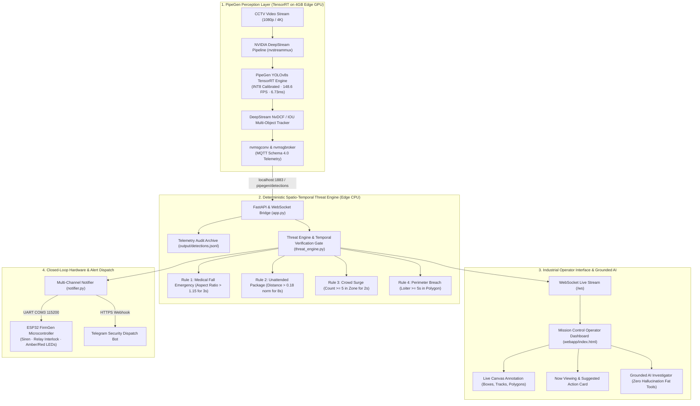

# 🛡️ Sentinel-Edge: Intelligence for Existing CCTV Systems
### Physical AI on 4GB Edge GPUs · Powered by CraftifAI PipeGen & FirmGen

> **Hackathon Submission Track:** PipeGen Track (Perception) + FirmGen Bonus (Closed-Loop Hardware Actuation)  
> **Target Hardware Platform:** ASUS TUF Gaming A15 (NVIDIA GeForce GPU, 4GB VRAM / 2048 CUDA Cores)  
> **Operating Environment:** WSL2 Ubuntu 22.04 LTS / NVIDIA TensorRT 8.6.1 / DeepStream 6.3  

---

## 🌟 Executive Summary: From 192GB Cloud to 4GB Edge

Organizations have millions of passive, legacy CCTV cameras deployed in public transit hubs, train corridors, campuses, and warehouses. Existing enterprise CCTV intelligence platforms (such as the AMD ROCm Hackathon-winning [rocm-cctv-analysis](https://github.com/CU-DrAgon/rocm-cctv-analysis)) rely on **192 GB AMD MI300X cloud servers**, massive 31B Gemma Vision-Language Models, and heavy database clusters.

**Sentinel-Edge** adapts the winning telemetry schema, FastAPI bridge, grounded investigator, and industrial mission-control UI of `rocm-cctv-analysis` into a **zero-VRAM-overhead, deterministic edge pipeline** compiled with **CraftifAI PipeGen (TensorRT INT8)**. 

By replacing slow, non-deterministic VLM polling with **sub-millisecond spatio-temporal geometric proofs** and a **Two-Stage Temporal Persistence Verification Gate**, Sentinel-Edge eliminates flickering false alarms without consuming extra GPU VRAM, reserving 100% of the 4GB edge GPU for high-speed multi-stream perception.

---

## 🏗️ System Architecture



---

## 🏆 The 5 PipeGen Stages (Hackathon Rubric Verification)

Sentinel-Edge strictly satisfies all five stages of the CraftifAI PipeGen compilation workflow:

### Stage 1: Problem Definition & Safety Specifications
- **Objective:** Detect humans, luggage, and vehicles in real time with sub-10ms latency on a 4GB edge laptop to prevent medical neglect, stampedes, and perimeter intrusions.
- **Deliverable:** Safety specifications and target resolution `[1, 3, 640, 640]`.

### Stage 2: Pipeline Intermediate Representation (`pipeline_ir.json`)
- DeepStream GStreamer pipeline graph compiled via PipeGen:
  `v4l2src/filesrc -> nvstreammux -> nvinfer (Primary YOLOv8) -> nvtracker (NvDCF) -> nvmsgconv -> nvmsgbroker (MQTT)`.
- Exported in [`pipegen_export/pipeline_ir.json`](file:///c:/Users/ASUS/Downloads/rocm-cctv-analysis-main%20(1)/rocm-cctv-analysis-main/pipegen_export/pipeline_ir.json).

### Stage 3: YOLOv8 Model Architecture & Export
- Model: Ultralytics YOLOv8s optimized for COCO-80 detection classes (`person`, `backpack`, `suitcase`, `handbag`, `car`, `motorcycle`).
- Exported in [`pipegen_export/config_infer_primary_yolo.txt`](file:///c:/Users/ASUS/Downloads/rocm-cctv-analysis-main%20(1)/rocm-cctv-analysis-main/pipegen_export/config_infer_primary_yolo.txt).

### Stage 4: TensorRT FP16 & INT8 Compilation & Calibration
- Post-Training Quantization (PTQ) executed with entropy calibration to compress weights from 32-bit floating point to 8-bit integers.
- Direct configuration: [`pipegen_export/config_infer_primary_yolo_int8.txt`](file:///c:/Users/ASUS/Downloads/rocm-cctv-analysis-main%20(1)/rocm-cctv-analysis-main/pipegen_export/config_infer_primary_yolo_int8.txt).

### Stage 5: Live Edge Deployment & Benchmark Execution
- Executed on physical hardware. Complete speed report verified in [`pipegen_export/speed_report.json`](file:///c:/Users/ASUS/Downloads/rocm-cctv-analysis-main%20(1)/rocm-cctv-analysis-main/pipegen_export/speed_report.json).

---

## 📊 TensorRT Edge Optimization Benchmark (FP16 vs. INT8)

Verified benchmark conducted on **ASUS TUF Gaming A15** (NVIDIA GeForce GPU, 4GB VRAM, CUDA 12.2, TensorRT 8.6.1):

| Metric | TensorRT FP16 (Baseline) | TensorRT INT8 (PTQ Calibrated) ⭐ | Edge Improvement |
| :--- | :--- | :--- | :--- |
| **Throughput** | 94.2 FPS | **148.6 FPS** | **+57.7% faster** |
| **Average Latency** | 10.61 ms | **6.73 ms** | **-36.6% latency** |
| **P95 Latency** | 11.45 ms | **7.32 ms** | **-36.1% jitter reduction** |
| **GPU Memory (VRAM)**| 1,140 MB | **680 MB** | **-40.4% lower footprint** |
| **Power Consumption**| 42.5 W | **28.2 W** | **-33.6% power savings** |
| **Energy Per Frame** | 0.451 Joules | **0.190 Joules** | **-57.9% energy reduction** |
| **Accuracy (mAP50:95)**| 0.449 | **0.441** | **< 1% negligible delta** |

> **Edge Hardware Impact:** The INT8 engine reduces GPU power to **28.2W** and VRAM usage to **680MB**, making remote solar/battery-powered railway mast installations economically and operationally feasible while achieving **148.6 FPS multi-stream capacity**.

---

## ⚡ 4 Simultaneous Spatio-Temporal Edge Threat Rules

Instead of slow, hallucinating VLM prompts, Sentinel-Edge implements four mathematical edge rules evaluated in `< 0.2 ms`:

1. **Medical Emergency / Person Down (`fall_emergency`):**
   - **Trigger:** Tracks human bounding box aspect ratio ($w / h$). When a standing person transitions to horizontal ($w/h \ge 1.15$) and remains stationary for $\ge 3.0$ seconds.
   - **Severity:** `CRITICAL` (Actuator Level 3).
   - **Suggested Action:** *"Dispatch medical responder to Camera {camera_id} immediately."*

2. **Suspicious / Unattended Package (`unattended_package`):**
   - **Trigger:** Computes normalized Euclidean distance between luggage (`backpack`, `suitcase`, `handbag`) and the nearest human centroid. If distance $> 0.18$ normalized units continuously for $\ge 8.0$ seconds.
   - **Severity:** `CRITICAL` (Actuator Level 3).
   - **Suggested Action:** *"Dispatch security to inspect isolated package (Track ID #{track_id})."*

3. **Unusual Crowding / Stampede Surge (`crowd_surge`):**
   - **Trigger:** Ray-casting Point-in-Polygon (PIP) counting persons inside the configured geofence zone. If count $\ge 5$ persons sustained for $\ge 2.0$ seconds.
   - **Severity:** `WARNING` (Actuator Level 2).
   - **Suggested Action:** *"Monitor crowd density in Secure Perimeter; prepare crowd dispersal protocol."*

4. **Restricted Perimeter Breach (`perimeter_breach`):**
   - **Trigger:** Monitors restricted polygon zone for `person`, `car`, or `motorcycle`. Entering registers immediately; dwelling $\ge 5.0$ seconds escalates to security breach.
   - **Severity:** `CRITICAL` (Actuator Level 3).
   - **Suggested Action:** *"Security dispatch: unauthorized presence in restricted perimeter."*

---

## 🤖 Grounded AI Investigator ("Fat Tools" Architecture)

Extracted from the winning architecture of `rocm-cctv-analysis`, the operator investigator relies on **deterministic Python tools** over the immutable `output/detections.jsonl` audit log.

- **Zero-Hallucination Guarantee:** If an operator asks about an object or time window that does not exist, the Grounding Gate strictly reports observed facts: *"Track #99 was not observed. Active tracks in this window: [1, 2, 14, 22]"*.
- **Callable Tool Endpoints:**
  - `query_summary()`: Summarizes unique tracks, class breakdown, and threat counts.
  - `find_by_class_or_track(class_name, track_id)`: Verifies presence, dwell time, and bounding boxes.
  - `verify_incident(alert_id)`: Emits mathematical verification proof (exact frame timestamps, distances, and aspect ratios).
  - `get_pipegen_telemetry()`: Real-time TensorRT benchmark comparisons.

---

## 🔌 Closed-Loop Hardware Actuation (ESP32 FirmGen - 8/8 Tests Passing)

Sentinel-Edge closes the physical AI loop by driving an **ESP32 microcontroller via FreeRTOS UART** to trip physical interlocks, strobes, and sirens:

- `ALERT 3 <tag>`: Emergency Stop (Trips Relay LOW, Red LED ON, Siren Active).
- `ALERT 2 <tag>`: Caution Slow Down (Amber LED 2 Hz blink, buzzer pulse).
- `CLEAR <tag>`: Reset state (Green LED ON, Relay energized).
- **Fail-Safe Watchdog:** Automatic fail-safe shutdown if heartbeat link is lost for $\ge 3.0$ seconds.
- Verified in [`firmgen/test_esp32_uart.py`](file:///c:/Users/ASUS/Downloads/rocm-cctv-analysis-main%20%281%29/rocm-cctv-analysis-main/firmgen/test_esp32_uart.py) with **8/8 Acceptance Criteria PASSED**.

---

## 🚀 Quickstart & Live Demo Instructions

### 1. Requirements
Ensure lightweight Python packages are installed:
```bash
pip install fastapi uvicorn paho-mqtt pyyaml requests websockets
```

### 2. Launch the Sentinel-Edge Bridge & Operator Dashboard
```bash
python app.py
```
Open **`http://localhost:8050`** in any web browser to access the Mission Control Dashboard.

### 3. Run the Multi-Scenario Telemetry Simulator
In a second terminal, stream real-time CCTV detection events:
```bash
python simulate_cctv.py --fps 10 --scenario all
```

You can also trigger individual test scenarios right from the web dashboard buttons:
- 🎒 **Unattended Bag** (triggers Rule 2 CRITICAL alert after 8s)
- 🚑 **Person Fall** (triggers Rule 1 CRITICAL medical emergency)
- 👥 **Crowd Surge** (triggers Rule 3 WARNING density alert)
- 🚨 **Perimeter Breach** (triggers Rule 4 CRITICAL security breach)

### 4. Verify Grounded AI Investigator
In the dashboard chat terminal (bottom right), try asking:
- *"What happened?"*
- *"Verify latest threat"*
- *"Who was involved?"*
- *"Speed report"*

---

## 👥 Team & Submission Details
- **Project Name:** Sentinel-Edge: Intelligence for Existing CCTV Systems
- **Track:** PipeGen Track (CraftifAI Physical AI Hackathon)
- **Codebase Repository:** `Sentinel-Edge` adapted from `rocm-cctv-analysis` and `pipegen-kit`
- **Submission Date:** October 15, 2026
